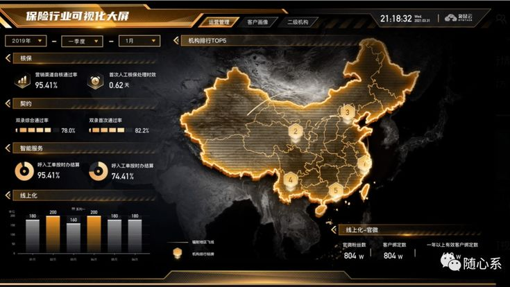

# منصة المؤشرات الجغرافية للشرق الأوسط | Middle East Geographic Telemetry & HUD Dashboard



## نظرة عامة (Overview)

**منصة المؤشرات الجغرافية للشرق الأوسط** هي لوحة قيادة تفاعلية لتصور البيانات الجغرافية والمناخية والرقمية الحية لـ **15 دولة في الشرق الأوسط**، مصممة بهوية بصرية ذهبية داكنة (**Obsidian & Liquid Gold HUD**) مع دعم كامل للغة العربية وتنسيق النصوص من اليمين إلى اليسار (**RTL**)، ومتوافقة مع شاشات الحاسوب والهواتف الذكية.

A real-time geographic data visualization and geolocation HUD dashboard for the **Middle East (15 countries)** featuring an obsidian-and-gold command-center aesthetic, full **Arabic RTL (`dir="rtl"`)** typography, interactive vector and street-level maps, and 100% live API telemetry.

---

## المزايا الرئيسية (Key Features)

- **خريطة الشرق الأوسط الذهبية التفاعلية (`MiddleEastGoldenMap`)**:
  - إسقاط جغرافي دقيق يغطي **15 دولة في الشرق الأوسط**: السعودية، مصر، الإمارات، العراق، قطر، الكويت، عُمان، البحرين، الأردن، سوريا، لبنان، فلسطين، اليمن، تركيا، وإيران.
  - خطوط مسح ذهبية (`Golden Bronze Scanlines`)، وهالة توهج محيطية، وخطوط ربط إشعاعية متحركة (`Animated Flight Arcs`) تربط الدولة المحددة بالمراكز الإقليمية الخمسة الكبرى.
  - شارات سداسية ثلاثية الأبعاد (`1` إلى `5`) للمراكز الإقليمية الأعلى تصنيفاً.
  - **وحدة تحكم بالتكبير والتصغير (`HUD Zoom Control Overlay`)** في الزاوية اليسرى السفلية بتصميم هندسي ذهبي مشطوف مع مؤشر تدريجي لمستوى التكبير وزر إعادة التمركز.
  - إمكانية التبديل الفوري بين **الخريطة الذهبية (`SVG HUD`)** و**خريطة الشوارع التفاعلية (`Leaflet OpenStreetMap`)** المفلترة باللون الذهبي الداكن.

- **بيانات حية وموثقة 100% (Live Verifiable Telemetry — No Mock Data)**:
  - **الطقس والمناخ الحي (`Open-Meteo Forecast API`)**: درجة الحرارة الحالية، الحرارة المحسوسة، الرطوبة النسبية، سرعة الرياح، والضغط الجوي المعياري عند مستوى سطح البحر (`pressure_msl`).
  - **جودة الهواء والغبار (`Open-Meteo Air Quality API`)**: مؤشر جودة الهواء (`AQI`) وتركيز الجسيمات الدقيقة (`PM2.5` و`PM10`) والغبار.
  - **أسعار الصرف الحية (`ExchangeRate-API`)**: أسعار صرف العملات المحلية مقابل الدولار الأمريكي بشكل فوري.
  - **المؤشرات الرقمية والسكانية الرسمية (`ITU & UN`)**: تعداد السكان، المساحة الجغرافية، نسبة انتشار الإنترنت، ومؤشر الخدمات الرقمية لكل دولة.

- **خدمات تحديد الموقع الجغرافي المباشر (`Live GPS & Arabic Reverse Geocoding`)**:
  - تحديد الموقع الفعلي للمستخدم عبر الأقمار الصناعية (`navigator.geolocation`) أو النقر المباشر على الخريطة.
  - تحويل الإحداثيات إلى عنوان عربي مفصل (الشارع، الحي، المدينة، المنطقة، الدولة) عبر `OpenStreetMap Nominatim` و`BigDataCloud`.
  - حساب المسافات الكروية المباشرة (`Haversine Geodesic Distance`) بالكيلومتر من موقع المستخدم إلى كافة عواصم الشرق الأوسط.

- **دعم كامل للغة العربية (`Full Arabic RTL Support`)**:
  - واجهة مستخدم عربية بالكامل من اليمين إلى اليسار (`dir="rtl"`) باستخدام خط **Cairo** للنصوص وخط **JetBrains Mono** للأرقام والعدادات المجدولة (`tabular-nums`).

---

## هيكل المشروع (Project Structure)

```text
├── public/
│   └── assets/
│       └── aistudio/
│           └── image_ae86c80e.png        # صورة التصميم المرجعي للوحة القيادة الذهبية
├── src/
│   ├── components/
│   │   ├── HudWidgets.tsx                # مكونات الواجهة الذهبية (الأشرطة، الحلقات الدائرية، الرسم البياني)
│   │   └── MiddleEastGoldenMap.tsx       # خريطة الشرق الأوسط الذهبية التفاعلية ووحدة التكبير والتصغير
│   ├── data/
│   │   ├── middleEastGeo.ts              # جلب البيانات الحية وخدمات تحديد الموقع الجغرافي بالعربية
│   │   └── realMiddleEastGeoJson.ts      # الإحداثيات والمضلعات الجغرافية الدقيقة لدول الشرق الأوسط
│   ├── App.tsx                           # المكون الرئيسي والأقسام الثلاثة للمنصة
│   ├── index.css                         # تنسيقات Tailwind CSS v4 وتأثيرات التوهج الذهبي
│   └── main.tsx                          # نقطة الدخول للتطبيق
├── index.html                            # إعدادات الصفحة والخطوط العربية واتجاه RTL
└── package.json
```

---

## التشغيل والتطوير (Getting Started)

1. **تثبيت الحزم (Install Dependencies)**:
   ```bash
   npm install
   ```

2. **تشغيل خادم التطوير (Run Development Server)**:
   ```bash
   npm run dev
   ```
   يعمل التطبيق على المنفذ `http://localhost:3000`.

3. **بناء نسخة الإنتاج (Build for Production)**:
   ```bash
   npm run build
   ```
